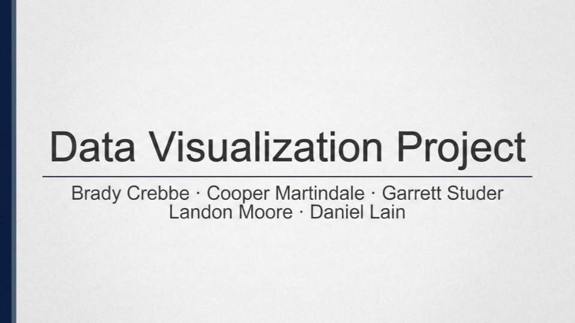
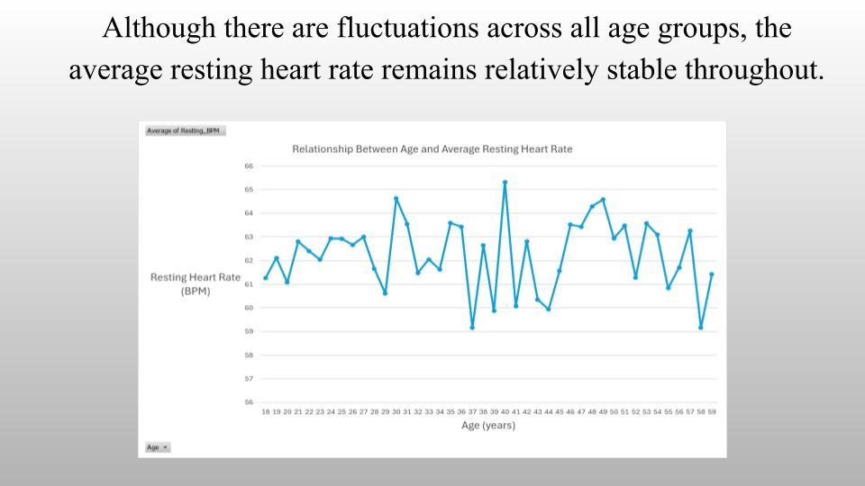
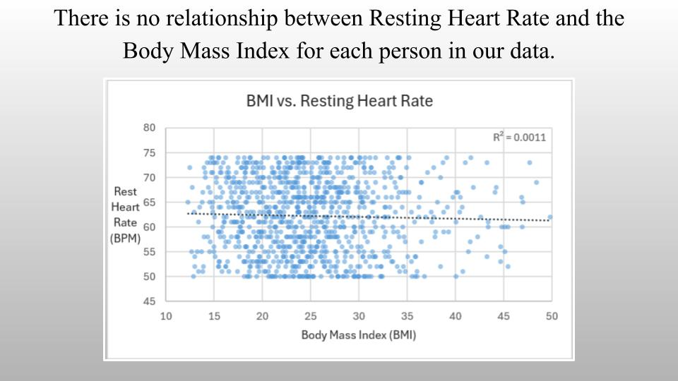
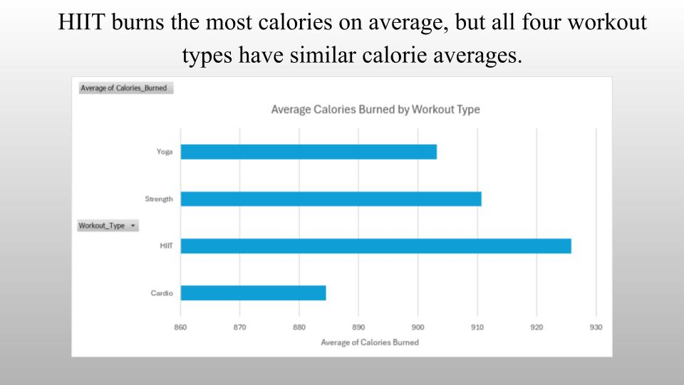
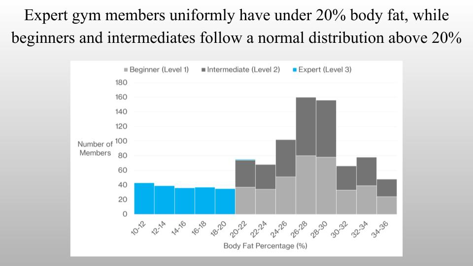

For this project we chose a data set that includes information of gym members of various backgrounds and goals when exercising. We are all interested in exercise and this data set provided us with the information to explore various topics and questions related to working out and exercising. 

The presentation given by our team can be found below with a brief explanation succeeding each slide.

We chose this question because understanding how people’s body works when exercising can be highly dependent factors such as age, body mass index, what workouts are being done, and how many calories are burned in correlation to these factors.In Excel, we created a Pivot Table using the columns “Age” and “RestingBPM”. We set Age as the rows and the average of RestingBPM as values, and created a time series plot highlighting the PivotTable.We found that although there are some fluctuations in resting heart rate through ages 30-45, the average resting heart rate remains relatively stable throughout.We used the time series plot from Excel and added it to our slide. We then included a statement explaining that the average resting heart rate remains stable throughout all ages in the sample.

We wanted to see whether people with a higher BMI have a higher resting heart rate, since a heavier body might make the heart work harder even at rest. We used the BMI and Resting_BPM columns to create a scatter plot, with BMI on the x-axis and resting heart rate on the y-axis, because both variables are continuous. I added a trendline and displayed the R^2 value to measure how much of the variation in resting heart rate BMI explains. We then formatted the chart by adjusting the axes, adding titles, and shrinking and adding transparency to the markers so the overlapping points were easier to see. We concluded there is no meaningful relationship between BMI and resting heart rate in our dataset. The points form an evenly spread cloud, and the trendline is almost flat, with an R^2 value of 0.0011, meaning BMI explains only about 0.1% of the variation in resting heart rate. Average resting heart rate stayed around 62 BPM across all BMI levels. We placed the scatter plot from Excel on the slide and wrote an assertion statement at the top: “There is no relationship between Resting Heart Rate and the Body Mass Index for each person in our data.” The chart serves as the evidence, with the flat trendline and R^2 value showing the result.

We wanted to see if different types of workouts burned more calories than others and whether there was a noticeable difference between them. We used Excel to calculate the average calories burned for each workout type using a PivotTable. We then created a bar chart to compare the results.HIIT had the highest average calories burned at 925.81, followed by strength training at 910.70, yoga at 903.19, and cardio at 884.51. Overall, the averages were fairly similar, showing that workout type did not have a strong relationship with calories burned in our dataset.We used the bar chart from Excel and added it to our slide. We included a statement explaining that HIIT burned the most calories on average, but the differences between workout types were relatively small.

We wanted to see how the experience people have at working out differs the distribution of body fat percentage of the people in the study.We made a stacked column chart with the distribution broken up into three different series for each expert level. We made the bins for each body fat percentage by counting the number of people in each 2% increment of body fat starting at 10%. Taking the counts we split them into columns based on which expert level they were and then took those columns against the bin ranges and made the bar chart. By reducing the distance between each bar to zero it forms a histogram.The histogram displays that the distribution for beginner and intermediate level people was a normal distribution, completely above 20%, while the expert level people showed a uniform distribution of body fat percentage for the range 10% to 20%.We placed the histogram from Excel onto a slide with formatting consistent with the other assertion slides and wrote a statement of describing the distribution of body fat percentage.

Team Members e-portfolios:

Me - https://bcrebbe.github.io/ 

Cooper Martindale - https://coopermartindale.github.io/

Garrett Studer - https://gstuder621.github.io/ 

Daniel Lain - https://dlain-uark.github.io/ 

Landon Moore - https://landonmo0re.github.io/ 

